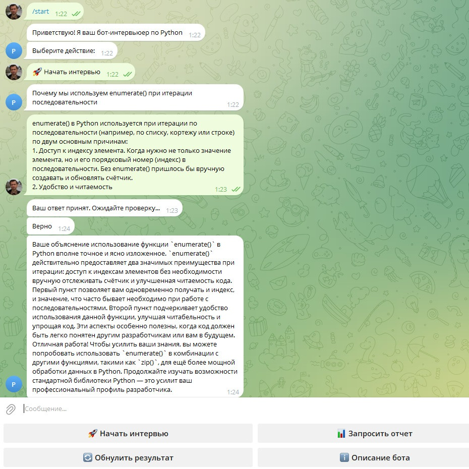
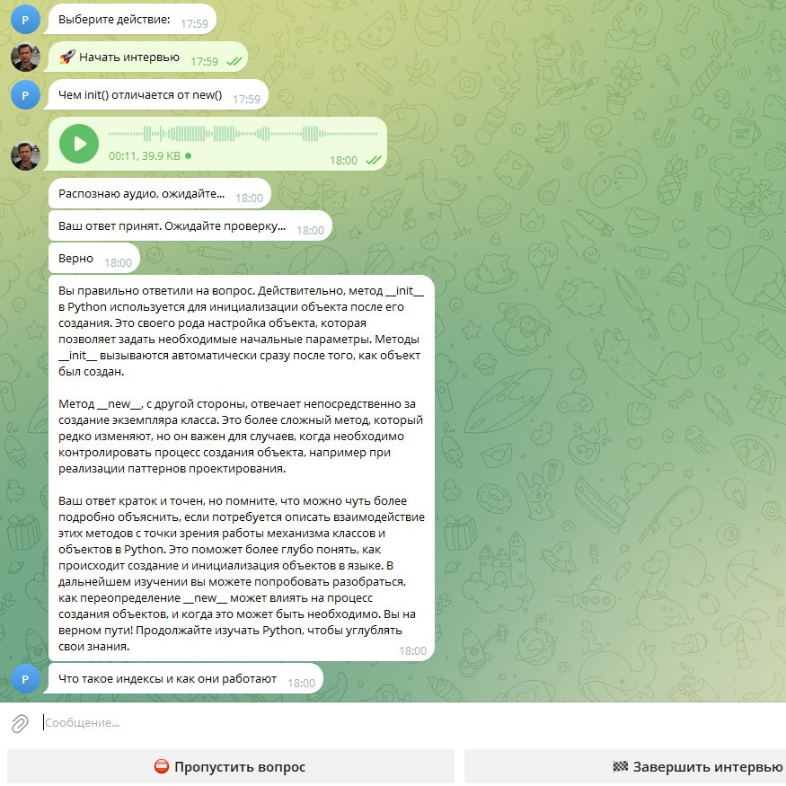
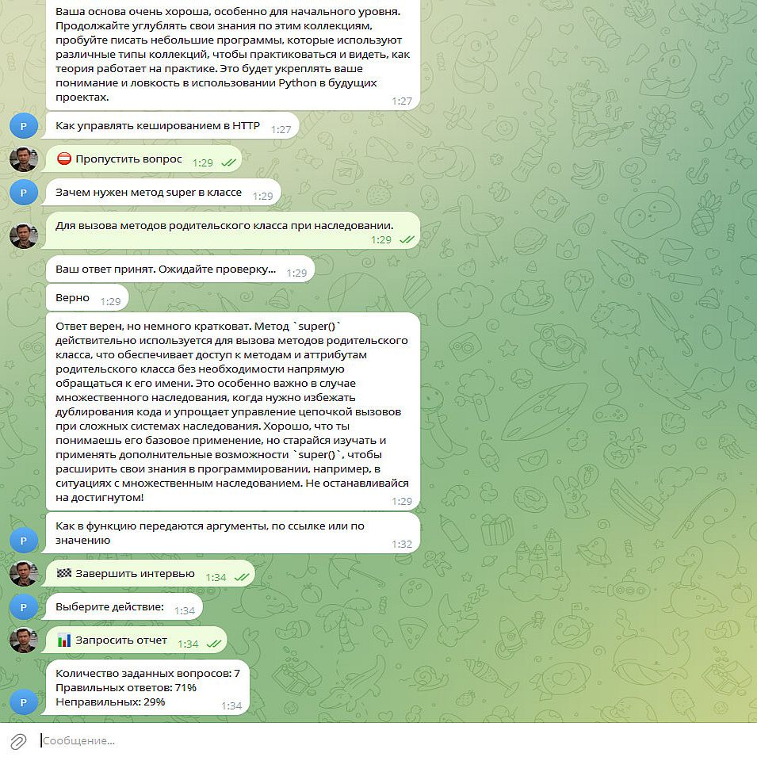

# AI-Python-Interviewer

**AI-Python-Interviewer** — Telegram-бот для подготовки к техническим собеседованиям на позицию Python-разработчика. Бот проводит тренировочные интервью, задаёт вопросы по Python, анализирует ответы с помощью искусственного интеллекта и предоставляет подробную обратную связь.

Проект помогает проверить знания, выявить пробелы в подготовке и повысить уверенность перед реальным собеседованием.

## Возможности

- **Тренировочное интервью:** последовательная выдача вопросов по Python из подготовленной базы данных.
- **Анализ ответов с помощью AI:** проверка ответов через OpenAI API с использованием настроенной языковой модели.
- **Оценка знаний:** каждый ответ получает оценку «Верно» или «Неверно».
- **Подробная обратная связь:** объяснение ошибок, разбор ответа и рекомендации по улучшению знаний.
- **Голосовые ответы:** возможность отвечать на вопросы голосовыми сообщениями.
- **Распознавание речи:** преобразование голосовых ответов в текст с помощью OpenAI Whisper API.
- **Управление интервью:** возможность завершить интервью в любой момент и продолжить его позже.
- **Статистика:** просмотр результатов интервью, включая общее количество вопросов, число правильных и неправильных ответов и процент правильных ответов.

## Демонстрация работы

### 1. Начало интервью



### 2. Пример вопроса голосом и ответ



### 3. Окончание и статистика интервью



## Как работает бот

1. Пользователь запускает бота в Telegram и начинает интервью.
2. Бот выбирает вопрос из базы данных и отправляет его пользователю.
3. Пользователь отвечает текстом или голосовым сообщением.
4. Если ответ голосовой, бот преобразует аудио в текст с помощью OpenAI Whisper API.
5. Полученный текст передаётся языковой модели OpenAI для анализа.
6. Бот возвращает оценку ответа («Верно» / «Неверно»), подробный разбор и рекомендации.
7. Пользователь может продолжить интервью, завершить его или посмотреть статистику.

## Используемые технологии

| Компонент | Технология | Назначение |
|---|---|---|
| Язык программирования | Python 3.8+ | Основная логика приложения |
| Telegram API | pyTelegramBotAPI | Взаимодействие с пользователем |
| База данных | SQLite | Хранение вопросов и данных интервью |
| AI-анализ | OpenAI API | Оценка и разбор ответов |
| Распознавание речи | OpenAI Whisper API | Преобразование голосовых ответов в текст |
| Обработка аудио | FFmpeg | Обработка и конвертация аудиофайлов |

## Структура проекта

```text
AI-Python-Interviewer/
│
├── main.py          # Основной файл, запуск Telegram-бота
├── backend.py       # Логика обработки и анализа ответов
├── init_db.py       # Инициализация базы данных
├── db_from_csv.py   # Загрузка вопросов из CSV
├── config.py        # Токены, настройки API и промпты
├── PythonTest.csv   # База вопросов по Python
├── interview.db     # База данных SQLite
└── README.md        # Документация проекта
```

## Требования

- Python 3.8 или выше.
- Telegram-бот, зарегистрированный через [@BotFather](https://t.me/BotFather).
- API-ключ OpenAI с доступом к используемым моделям.
- FFmpeg.

## Установка и запуск

### 1. Клонирование репозитория

```bash
git clone https://github.com/Anatolium/AI-Python-Interviewer.git
cd AI-Python-Interviewer
```

### 2. Создание виртуального окружения

```bash
python3 -m venv .venv
source .venv/bin/activate
```

### 3. Установка зависимостей

Обновите pip и установите необходимые библиотеки:

```bash
pip install --upgrade pip
pip install pyTelegramBotAPI openai requests python-dotenv ffmpeg-python
```

### 4. Установка FFmpeg

Для Ubuntu/Debian:

```bash
sudo apt update
sudo apt install ffmpeg
```

### 5. Настройка конфигурации

Создайте файл `config.py` в корневой директории проекта.

Укажите в нём необходимые параметры:

```python
BOT_TOKEN = "YOUR_TELEGRAM_BOT_TOKEN"
OPENAI_API_KEY = "YOUR_OPENAI_API_KEY"
OPENAI_WHISPER_API_KEY = "YOUR_OPENAI_WHISPER_API_KEY"

SYSTEM_PROMPT = "Your system prompt"
WHISPER_PROMPT = "Your Whisper prompt"

DB_NAME = "interview.db"
```

- `BOT_TOKEN` — токен Telegram-бота, полученный через BotFather.
- `OPENAI_API_KEY` — API-ключ для анализа ответов.
- `OPENAI_WHISPER_API_KEY` — API-ключ для распознавания голосовых сообщений.
- `SYSTEM_PROMPT` — системный промпт, определяющий правила оценки и формат обратной связи.
- `WHISPER_PROMPT` — подсказка для распознавания профессиональной терминологии.
- `DB_NAME` — имя файла базы данных SQLite.

Настройки языковой модели и параметры её работы также задаются в `config.py`.

**Важно:** не публикуйте `config.py` с реальными токенами и API-ключами в открытом репозитории.

### 6. Инициализация базы данных

Создайте структуру базы данных:

```bash
python init_db.py
```

Загрузите вопросы из CSV-файла:

```bash
python db_from_csv.py
```

Убедитесь, что файл `PythonTest.csv` находится в корневой директории проекта.

### 7. Запуск бота

```bash
python main.py
```

После запуска бот готов принимать сообщения в Telegram.

## Лицензия

Проект распространяется под лицензией [Apache License 2.0](http://www.apache.org/licenses/LICENSE-2.0).